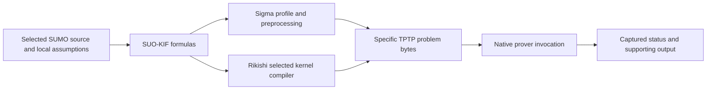

# The ontology and reasoning systems

The Suggested Upper Merged Ontology (SUMO) is authored in Standard Upper
Ontology Knowledge Interchange Format (SUO-KIF). The Sigma Knowledge
Engineering Environment (KEE) manages and translates selected content into
Thousands of Problems for Theorem Provers (TPTP) languages for native provers.
These components occupy different places in the same workflow.
An ontology supplies a theory; a language expresses it; an
engineering environment manages and translates it; a target language states a
precise reasoning problem; a prover searches that problem. A result needs the
identities of all those stages.

## Follow the information through the pipeline

The two translation paths are alternatives with different contracts. Rikishi's
selected kernel compiler does not reproduce the whole Sigma preprocessing
pipeline. A cached or configured background can differ from the source corpus
being browsed, so a corpus manifest and a submitted problem need separate
identities.

| Component | Its role | What its presence does not establish |
| --- | --- | --- |
| SUMO source distribution | Upper, middle-level and domain theories, plus lexical/presentation resources. | One load profile does not contain every indexed file. |
| SUO-KIF | Authoring notation for formulas, terms, variables and richer constructs. | Parser acceptance does not establish the intended interpretation or consistency. |
| Sigma KEE | Ontology engineering, browsing, static analysis, preprocessing and prover integration. | A historical system paper does not authenticate an installed binary, cache or configured background. |
| TPTP | A family of target languages and conventions for annotated problems and solutions. | Saying “TPTP” alone does not specify the logic variant, arithmetic or a semantic-preservation policy. |
| E and Vampire | Native automated reasoning systems applied to a specified input and options. | One result does not certify every translation step, all source files or all possible queries. |
| Rikishi | Source indexing, declared projections, selected controlled campaigns, finite calculations and retained evidence replay. | Agreement on selected witnesses does not prove a universal SUMO–Lean translation. |

Sigma's engineering role is described in the
[Sigma KEE3.0 system paper, §§2–4](https://adampease.com/pe_sch_sigma.pdf).
Its account explains an integration design; current execution claims belong
to the pinned runtime and captured inputs documented in
[runtime findings](../runtime/runtime.md).

## TPTP is a language family

The [official TPTP language reference](https://tptp.org/UserDocs/TPTPLanguage/TPTPLanguage.shtml)
distinguishes First-Order Form (FOF), Typed First-order Form (TFF) and Typed Higher-order Form (THF),
among other forms. Annotated statements carry a name, role and formula.
Premises with axiom-like roles are accepted as the problem's basis; the target
format does not guarantee that they are mutually consistent.

For a classical first-order query, proof by refutation adds the negation of the
conjecture and seeks inconsistency. A theorem outcome can be vacuous if the
background was already inconsistent. Rikishi therefore uses satisfiable
backgrounds, negative queries, removed-premise cases and direct refutation cases
as separate obligations in selected campaigns.

The [SZS status specification](https://szs.tptp.org/) distinguishes theorem,
counter-satisfiable, satisfiable, unsatisfiable and inconclusive outcomes.
A timeout is not a negative answer. A countermodel concerns the submitted
problem, including its actual premises and target interpretation. A captured
status also differs from independently checking every inference in a proof
calculus; Rikishi's [verification guide](../methods/verification.md) states the
boundary.

## Translation is part of the method

Sigma's first-order path handles authoring conveniences by explicit
preprocessing, including finite predicate instantiation and argument-sequence
expansion. Its typed arithmetic path additionally reconciles numerical target
sorts with SUMO's hierarchy. These transformations must be identified with the
problem, since the source's inheritance structure does not become a target's
built-in sort system unchanged. See Pease's
[translation paper, §§1–2](https://arxiv.org/html/2303.04148v1).

Rikishi instead declares a function-free selected fragment. Object constants and
predicate symbols occupy separate target namespaces; any predicate-variable
specialization is recorded. Numbers in that fragment are object constants,
and probability arithmetic is performed separately. These choices keep the
tested interpretation inspectable and leave broader translation obligations
to [semantic transport](../methods/semantic-transport.md).

## Related representations answer different questions

| Resource or approach | What it provides | How to compare it responsibly |
| --- | --- | --- |
| Resource Description Framework (RDF) | A graph data model based on subject–predicate–object triples. | A triple export needs a policy for n-ary relations, quantifiers and contextual formulas. Rikishi's asserted-edge graph is not a complete RDF encoding of the source theory. |
| Web Ontology Language (OWL) | An ontology language with specified semantics and several language variants/profiles. | Identify the OWL variant and mapping. Similar class/property labels do not establish equivalence to expressive SUO-KIF. |
| Adimen-SUMO | A reengineered first-order ontology derived from studied SUMO upper/middle content. | Its translation, repairs and additional axiomatization make it a distinct theory; compare exact versions and axioms. |
| SUMO-K | A defined fragment interpreted in higher-order set theory, with sequence arguments and class formation. | Its semantic construction and proof tasks belong to that fragment; the reported treatment excludes temporal, modal and probabilistic operations. |
| WordNet–SUMO mappings | Links from lexical synsets to ontology concepts using specified mapping relations. | Retain the WordNet version, synset and mapping label; a lexical correspondence is not an executed ontology proof. |

The RDF distinction follows the [W3C RDF1.1 abstract syntax](https://www.w3.org/TR/rdf11-concepts/#section-rdf-graph).
The [OWL2 primer, §§2,4,9–10](https://www.w3.org/TR/owl2-primer/)
explains its classes/properties, open-world reading, identity conditions and
language variants. OWL also lacks a required unique-names assumption; that
shared feature alone does not make OWL and a SUMO translation interchangeable.

The Adimen-SUMO project's [primary overview](https://adimen.ehu.eus/web/adimenSUMO)
describes translation and repair, while its
[competency-evaluation paper, §2](https://adimen.ehu.eus/web/files/AdimenSUMO/k-cap2015.alrA.pdf)
separates first-order variants and their selected source levels. Brown, Pease
and Urban give the [SUMO-K construction, §§2–3](https://arxiv.org/html/2305.07903v1).
Neither derived theory is the current Rikishi SUMO pin by another name.

WordNet is a lexical resource organized around word senses. The mapping
methodology distinguishes equivalence, subsumption and instantiation in
[Niles and Pease, §3](https://adampease.com/Niles-IKE.pdf).
The pinned [WordNet3.0 noun header](https://github.com/ontologyportal/sumo/blob/efcd059f8feebfe3488a09f575f88d4d009b1e5c/WordNetMappings/WordNetMappings30-noun.txt#L1-L29)
defines the `=`, `+`, `@` labels and their complementary forms `:`, `[` and `]`.
These are mapping-file conventions, not a blanket permission to replace them
with logical identity or to infer ontology truth from an English synonym.

## Read a Rikishi result with the right authority

The [source demonstration](sumo-demonstrations.md) establishes selected source
assertions and projection behavior. The [inference method](../methods/inference-methods.md)
owns selected logical obligations. The [finite study](../research/research.md)
owns its separate numerical and first-order logic (FOL) experiments. The
[shared-witness bridge](../methods/bridge-methods.md) connects particular
representations to concrete Lean and numerical inputs. Published scholarship
motivates and situates those methods; the
[claim ledger](../research/scholarship.md) states what each source supports.

For an outcome, inspect the declared source revision, complete selected
formulas and assumptions, actual target bytes, executable/options, deadline,
raw output and independent report digest. These details identify the question
that was answered. They also keep a source classification, a native proof,
a numerical identity and a scientific interpretation from being mistaken for
one another.
